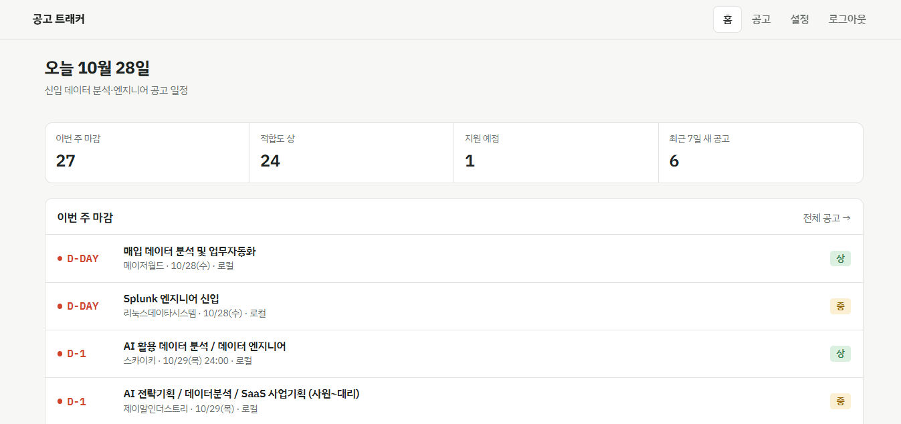
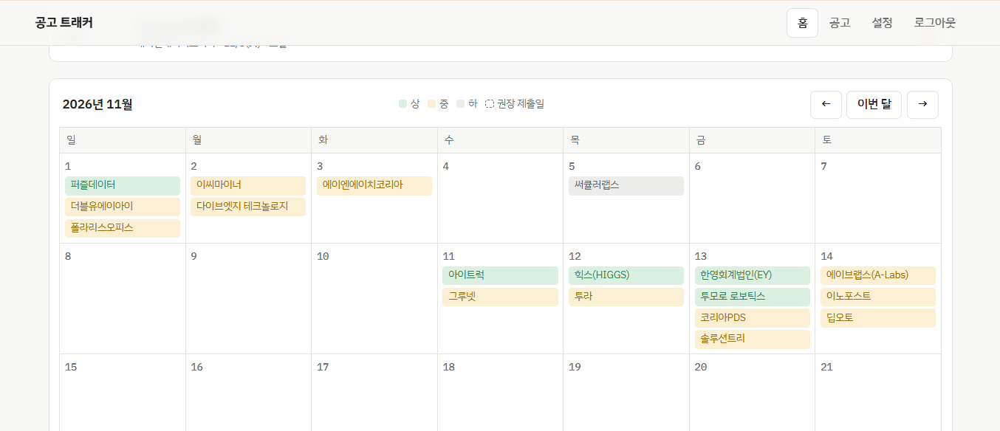
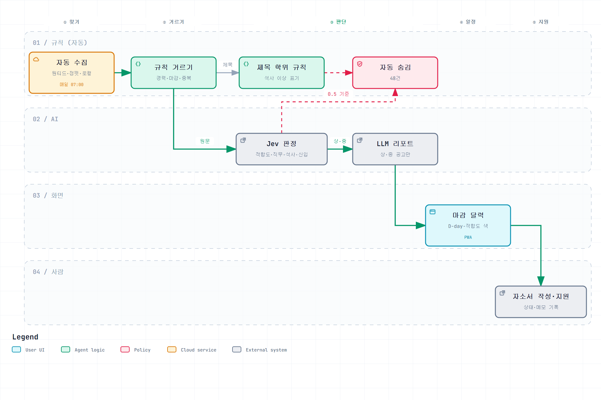
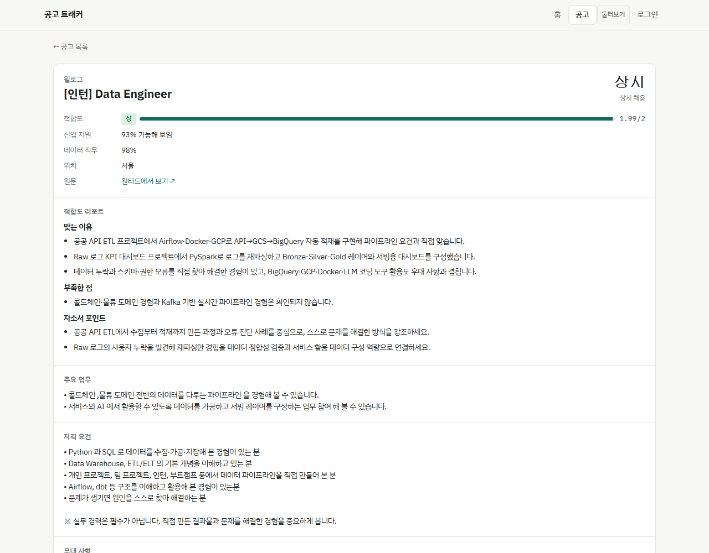
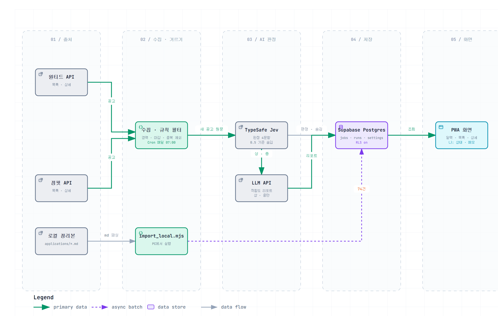

# job-tracker — 채용 공고 탐색·일정 관리 업무 AX

원티드·점핏·로컬 정리본에 흩어진 신입 데이터 공고를 매번 찾아 읽고, 나와 맞는지 판단하고, 마감을 손으로 챙기던 반복 업무를
**반복 작업은 규칙, 원문 판단은 AI, 자소서 작성 후 지원만 사람이** 하도록 다시 나눈 개인용 앱.

**사이트** https://job-tracker-six-vert.vercel.app ('로그인 없이 둘러보기' — 지원 상태·메모는 가려짐)
**스택** Next.js 15 · TypeScript · Supabase Postgres · Vercel (서버리스 + Cron) · TypeSafe Jev · LLM API(OpenAI) · PWA





## 30초 요약

| | |
| --- | --- |
| **문제** | 공고가 여러 사이트에 흩어져 있고, 지원 가능 여부(석사 필수·직무)를 알려면 원문을 하나씩 읽어야 하고, 마감은 따로 적어 챙겨야 했다 |
| **해결** | 업무를 찾기·거르기·판단·일정·지원 5단계로 나눠 단계마다 규칙 / AI / 사람에게 맡겼다 |
| **결과** | 3개 출처 공고 189건을 한 DB·마감 달력으로 통합, 매일 07시 자동 갱신. 자동 수집 115건 중 지원 불가 48건 자동 제외(경계 점수 공고는 원문과 대조해 모두 정확). 적합도 상·중 공고에만 LLM 리포트 131건 |

## 단계별로 누가 하나



| 단계 | 예전 (수작업) | 지금 | 담당 |
| --- | --- | --- | --- |
| ① 찾기 | 사이트마다 검색 | 매일 07시 실행, 5일마다 원티드·점핏 API 수집 + 로컬 정리본 이관, 중복 제거 | 규칙 |
| ② 거르기 | 제목·마감 보고 하나씩 제외 | 제목 정규식(경력·시니어 제외), 마감 지난 공고 제외 | 규칙 |
| ③ 판단 | 원문을 읽고 판단 | Jev 확률 판정 4가지 + 제목 학위 표기 규칙 → 숨김 / LLM 리포트 | AI (+규칙) |
| ④ 일정 | 마감일을 따로 적어 둠 | 마감 달력·D-day·권장 제출일 (폰에 PWA 설치) | 화면 |
| ⑤ 지원 | 지원 여부 결정·자소서·지원 | 그대로. 리포트의 자소서 포인트를 참고해 쓰고, 상태·메모만 기록 | 사람 |

## AI 판단 기준 (Jev)

공고마다 질문 4개를 한 요청으로 보낸다. 입력은 내 경험 요약(약 1,000자)과 공고(제목·주요 업무·자격·우대·스택). 생성형 LLM이 아니라 확률·점수를 돌려주는 판정 모델이라, 결정은 코드의 임계값이 한다.

| 질문 | 형식 | 기준 | 쓰는 곳 |
| --- | --- | --- | --- |
| 적합도 | 점수 0~2 | 상: 주요 업무 대부분을 프로젝트에서 직접 해 봄 / 중: 일부 겹침 / 하: 거의 안 겹침 | 상·중만 LLM 리포트 |
| 데이터 직무 | 예·아니오 확률 | 주 업무가 데이터 분석·엔지니어·사이언스·ML 데이터 직무인가 | 0.5 미만이면 숨김 |
| 석사 필수 | 예·아니오 확률 | 석사 이상·대학원 재학·전문연구요원이 **필수**인가 (우대만이면 아니오) | 0.5 이상이면 숨김 |
| 신입 지원 | 예·아니오 확률 | 경력 없는 졸업생이 필수 요건을 맞출 수 있나 | 표시만 |

본문에 학위 조건이 없어 Jev가 놓치는 공고(제목에만 "석사 이상", "전문연구요원")는 제목 규칙으로 보완한다. 석사 필수 25건 = Jev 16 + 제목 규칙 9.



## 구조



다이어그램 원본: `docs/diagrams/*.json` → [archify](https://github.com/tt-a1i/archify)로 만든 HTML(`docs/diagrams/*.html`, 확대·경로 추적 가능)

- **무료 요금제 제약 안에서**: 함수 실행 한도 300초 → 수집은 170초까지, 남은 시간에 4개씩 동시 처리, 1회 처리 건수 제한(채점 80·리포트 40). 못 끝낸 건 다음 실행으로 넘어간다. Cron이 하루 1회라 매일 깨우되 마지막 수집 시각과 주기 설정을 보고 코드에서 수집 여부를 정한다.
- **접근**: 쿠키 비밀번호 로그인(관리자 / 보기 전용 / 둘러보기). Cron은 전용 비밀값으로만 호출. Supabase는 전 테이블 RLS on + 정책 없음 → 공개 API로는 접근 불가, 서버의 DB 직접 연결로만 읽고 쓴다.

```
web/src/lib/   collect.ts(수집) · jev.ts(판정) · report.ts(LLM 리포트) · pipeline.ts(실행 순서·숨김 규칙) · auth.ts
web/src/app/   화면과 API (/api/cron, /api/run, /api/jobs/[id], /api/settings, /api/login)
scripts/       import_local.mjs(로컬 → DB) · sync_local.mjs(DB → 로컬) · make_icons.py
```

## 한계

- 사용자는 나 한 명, 2026-10-17부터 운영
- 적합도 상·중·하는 아직 수작업 판단과 대조 검증 전 (석사 필수만 원문 대조로 확인)
- 신입 지원 점수는 신입 공고에서도 낮게 나와(평균 0.38) 거르기에 쓰지 않는다
- 원티드 공고 대부분이 상시 채용이라 달력은 성기다

## 실행

```bash
cd web && npm install
# 상위 폴더 .env: DATABASE_URL, TYPESAFE_API_KEY, OPENAI_API_KEY, OPENAI_MODEL, APP_PASSWORD, VIEW_PASSWORD, CRON_SECRET
npm run dev
```

DB 스키마: `jobs`(공고·판정·리포트·내 상태), `runs`(실행 기록), `settings`(주기·경험 요약·기준값).

코드 구현은 Claude Code와 함께 했고, 문제 정의·단계 설계·판정 기준·검증은 직접 했다.
